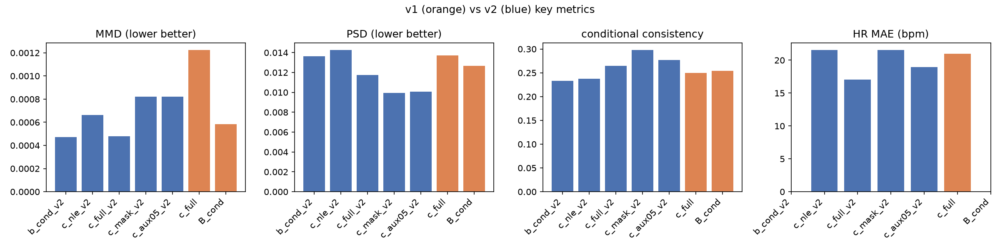
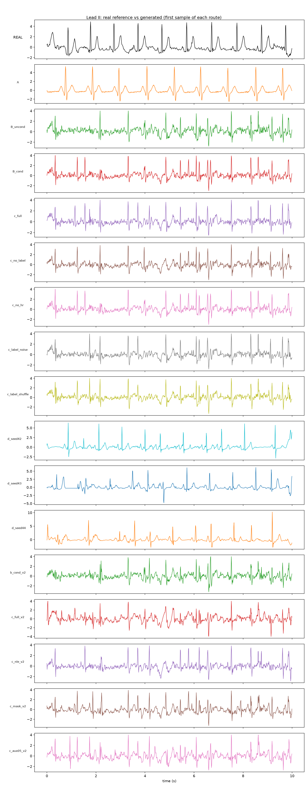
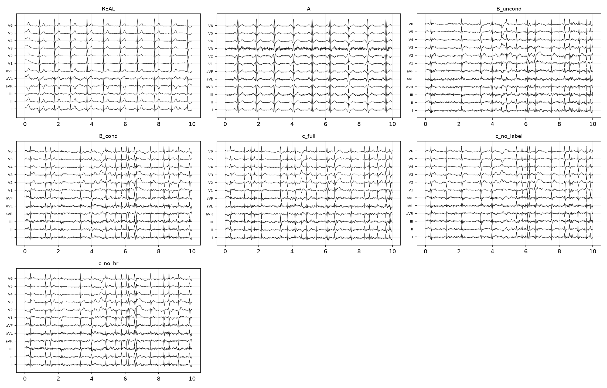

# 心电生成与诊断系统（PTB-XL）

> **在单卡 8GB 消费级 GPU 上构建的 12 导联 ECG 生成与诊断系统**：
> 4 类生成路线（机理 ODE / 条件扩散 / GAN）+ 统一三层评估（形态 / 规律 / 功能）+ TSTR 下游效用与一致性诊断
> + Streamlit 三功能区演示 + 可复现流水线（含诚实负结果记录）。
>
> **GitHub 仓库**：<https://github.com/CNCliMo/ecg-generation-portfolio>

**导航**：[方法说明](docs/METHOD.md) · [数据集指南](docs/DATA.md) ·
[模型权重说明](docs/CHECKPOINTS.md) · [实验清单](docs/EXPERIMENTS.md) ·
[局限性](docs/LIMITATIONS.md) · [文献综述](docs/PAPERS_ECG_GENERATION.md) ·
[v2 设计与结果](docs/V2_DESIGN.md) · [W2 实验报告](results/w2_report.md) ·
[演示 GIF](results/figures/demo.gif) · [目录结构](PROJECT_LAYOUT.md)

> **数据集不随仓库分发（约 2.4 GB）**：首次使用请按 [docs/DATA.md](docs/DATA.md) 自行下载
> （`python preprocess/download_data.py`，约 1.9 GB），再运行 `python preprocess/check_data.py` 校验。

---

## 1. 30 秒看懂

**问题**：合成 ECG 可用于隐私安全的数据增强与临床教育，但"生成得像不像、有没有用、能不能控制"需要统一口径的评估。

**做了什么**：
- 在 PTB-XL（21,388 条 10s 12 导联，fold 1–8/9/10）上实现 **4 类生成路线**，每条路线生成 ≥500 条件 + 1000 无条件信号；
- 实现 **多标签诊断分类器**（5 超类，test macro-F1 0.68 / macro-AUROC 0.90）并用于功能层与下游评估；
- 建立 **统一三层评估**：ecgen-eval 形态层（MMD/DTW/PSD/PRD + 6 项扩展）、规律层（QT/PR/QRS/RR-CV 的域内 + MIT-BIH 跨域 + ΔWasserstein）、功能层（条件一致率 / 类别分布 KL）；
- v2 追加 **nle 式标签嵌入、间期辅助监督（规律注入）、EMA**，并新增 **TSTR/TRTS 下游效用** 与 **一致性诊断**（HR 一致性 / 标签 TPR / 导联一致性 / k-NN coverage / classifier-FID）；
- 提供 **Streamlit 三功能区界面**（上传诊断 / 可控生成 / 多路线对比），AppTest 自动验收 PASS。

**关键结果**（v1 基线 → v2 改进）：

| 指标 | v1 | v2 | 说明 |
|---|---|---|---|
| 形态层 MMD ↓ / PSD ↓ | 0.0012 / 0.0137 | **0.0005 / 0.0117** | 越接近 0 越好 |
| QT 域内 Wasserstein ↓ | 102.9 ms | **85.2 ms** | 越低越接近真实节律 |
| HR 条件 MAE ↓ | 21.0 bpm | **17.1 bpm** | 目标心率与生成心率之差 |
| TSTR macro-F1 ↑ | 0.246 | **0.339** | 生成数据训练分类器→真实测试 |
| 诊断分类器 macro-F1 ↑ | 0.6838 | **0.6868 / 0.6970（阈值校准）** | PTB-XL fold 10 |





**快速开始**（详见 §4；当前环境环境已就绪）：

```powershell
powershell -File tools/run.ps1 tools/env_check.py    # 环境自检（完全隔离的 .venv_iso）
powershell -File tools/run_eval_all.ps1              # 全量评估 → metrics.csv + 图 + summary
powershell -File tools/run_app.ps1                   # 交互界面 http://127.0.0.1:8501
powershell -File tools/run.ps1 tools/test_app.py     # 界面无头验收（AppTest）
```

> 完整指标：`results/metrics.csv`（762 行、17 条路由）；摘要：`results/summary.md`、`results/summary_v2.md`。
> 诚实的负结果：`docs/LIMITATIONS.md`（nle 小预算下无显著优势、TSTR 远低于真实数据、GAN 方差大、HR 条件仍弱等）。

---

## 2. 关键结果

### 2.1 诊断分类器（PTB-XL fold 10 测试集）

| 版本 | macro-F1 | micro-F1 | macro-AUROC | macro-AP |
|---|---|---|---|---|
| v1（1D ResNet, base 64） | 0.6838 | 0.7378 | 0.8975 | 0.819 |
| v2（base 96 + label smoothing + EMA + 阈值校准） | 0.6868（fixed）/ **0.6970（tuned）** | 0.7437 | 0.8975 | 0.8129 |

### 2.2 四类生成路线（形态层，真实参考 = PTB-XL 测试集，越低越好）

| route | MMD | DTW | PSD | PRD |
|---|---|---|---|---|
| A 机理模型（McSharry ODE） | 0.00262 | 10.99 | 0.03451 | 130.24 |
| B_uncond 扩散（无条件） | 0.00055 | 10.90 | 0.01413 | 122.10 |
| B_cond 扩散（标签条件） | 0.00058 | 10.79 | 0.01267 | 121.29 |
| c_no_label（C 消融最优） | **0.00013** | 10.80 | 0.01391 | 121.51 |
| D GAN（3 seed 均值±std） | 0.0168±0.0221 | 10.83±0.11 | 0.0162±0.0126 | 125.89±4.83 |

### 2.3 v2 改进与消融（2×2 对照）

| 配置 | 标签嵌入 | 间期辅助损失（规律注入） | MMD↓ | PSD↓ | QT W↓ | HR MAE↓ | TSTR↑ |
|---|---|---|---|---|---|---|---|
| `c_full`（v1 基线） | mask | 无（基线） | 0.0012 | 0.0137 | 102.9 | 21.0 | 0.246 |
| **`c_full_v2`** | nle | 有（λ=0.1） | **0.0005** | 0.0117 | **85.2** | **17.1** | **0.339** |
| `c_mask_v2` | mask | 有（λ=0.1） | 0.0008 | **0.0099** | 91.9 | 21.6 | **0.407** |
| `c_nle_v2` | nle | 无（消融） | 0.0007 | 0.0143 | 104.3 | 21.6 | 0.166 |
| `c_aux05_v2`（W2） | nle | 有（λ=0.5） | 0.0008 | **0.0101** | 85.7 | 18.9 | **0.377** |
| `b_cond_v2` | nle | 无（仅标签条件） | 0.0005 | 0.0136 | 105.1 | N/A | 0.133 |

> 说明："无"表示该配置**有意不启用**间期辅助损失（v1 基线 / 对照消融），**不是实验未完成**；
> 以上配置均已完成训练与评估；λ=0.5 已由 W2 补齐，λ 扫描结论见 `results/w2_report.md`。

**结论**：规律注入（间期辅助损失）有效（QT W 85.2 vs 104.3、TSTR 0.339 vs 0.166）；nle 标签嵌入效果混合（小预算限制，未复现文献显著优势，如实记录）。

> **W2 补充实验（2026-11-07）**：λ 扫描（0/0.1/0.5）确认规律注入有效且 λ=0.1 最均衡；TSTR 放大显示合成数据
> "数量饱和"（500→2000 提升、2000→8000 停滞）；指标-效用分析显示 PSD/QT W 是最可信的效用代理。
> 详见 `results/w2_report.md` 与 `docs/EXPERIMENTS.md` §3。

### 2.4 图与表

- 图：`results/figures/`（18 张：波形/12 导联/FFT/形态柱状/规律分布/跨域 Δ/类别分布/训练曲线/下游/一致性/v1-v2 对比/λ 扫描/TSTR scaling/指标-效用/冗余…）；
- 表：`results/metrics.csv`（形态/规律/功能/下游/一致性 全表）、`results/summary.md`、`results/summary_v2.md`。

---

## 3. 方法概览

### 3.1 数据与预处理

- **PTB-XL 1.0.3**：100 Hz、12 导联、10s；官方 fold 1–8/9/10 = 17,084 / 2,146 / 2,158；
  0.5–40 Hz Butterworth 带通（3 阶零相位）+ 逐导联 z-score（100 Hz 下 50 Hz 陷波不可定义，跳过；偏差记录见 §6）。
- **标签**：`scp_statements.csv` 中 `diagnostic==1` 聚合为 NORM/MI/STTC/CD/HYP 多标签，无诊断记录剔除。
- **心率标签**：Lead II Pan-Tompkins 式 R 峰检测（与 NeuroKit2 交叉验证），均值 73.9 bpm，失败 262 条已记录。
- **MIT-BIH**：360 Hz 不重采样，仅 `'N'` 心搏（75,001 个）用于**跨域评估参考**，不参与训练/调参。
- **间期目标**（v2 规律注入）：`preprocess/cache/interval_targets_{train,val}.npz`，NeuroKit2 delineate，
  中位 QT/PR/QRS ≈ 390/120/110 ms（失败样本记录在报告）。

### 3.2 四类生成路线

| 路线 | 方法 | 代码 | 说明 |
|---|---|---|---|
| A 机理 | McSharry 三耦合 ODE + 心率缩放 + 12 导联投影 | `models/mechanistic.py` | 无训练，生成 500 条件 + 1000 无条件 |
| B 标准扩散 | DDPM ε-prediction，1D U-Net + 自注意力 + FiLM 条件 | `models/diffusion.py` | v1：base 32 / 100 epochs；条件模式 none/label |
| C 规律注入扩散 | B 的骨干 + 条件编码器（标签 + 心率）+ 消融 5 配置 | `models/diffusion.py` | v2 增加 nle 标签嵌入 + 间期辅助损失 + EMA |
| D GAN | Pulse2Pulse 风格 1D 生成器 + PatchGAN | `models/gan.py` | 3 个固定 seed，报告均值±方差 |

生成约定：`float32 (N,12,1000)`、100 Hz、逐导联 z-score、Lead II = 索引 1；DDIM 50 步（v2 用 EMA 权重）。

### 3.3 三层评估 + v2 扩展

1. **形态层**：ecgen-eval `mmd/dtw/psd/prd` + `fd/swd/nn_dist/pr_dist/heart_rate/spectral_entropy`（v2）；
2. **规律层**：QT/PR/QRS/RR-CV，NeuroKit2 delineate，Wasserstein（主）+ KS；域内 vs MIT-BIH 跨域参考；
   **ΔWasserstein = 跨域 − 域内**；delineate 失败数逐路线记录（不静默丢弃）；
3. **功能层**：条件一致率（宏平均 + 每类）+ 无条件 5 类预测分布 vs 真实分布的 KL；
4. **v2 新增**：`eval_downstream.py`（TSTR/control/TRTS）、`eval_consistency.py`（HR 一致性、标签 TPR/TNR、
   导联一致性残差、k-NN coverage/precision、classifier-FID）。

### 3.4 诊断分类器

1D ResNet（4 个残差阶段 + 全局池化 + 5 sigmoid），BCE 多标签；v1 base 64 / 40 epochs；
v2 base 96 + label smoothing + EMA + 阈值校准。用于功能层、下游 TSTR/TRTS 与一致性诊断。

---

## 4. 快速开始

### 4.1 环境

当前环境使用**完全隔离的 `ECG/.venv_iso`**（约 5.1GB，torch 2.5.1+cu121 与全部依赖自包含，不依赖 conda）。

```powershell
powershell -File tools/run.ps1 tools/env_check.py     # 期望：全部 OK + CUDA True
powershell -File tools/run.ps1 tools/which_env.py     # 依赖来源审计
```

通用机器：

```bash
python -m venv .venv_iso && . .venv_iso/bin/activate
pip install -r requirements.txt
pip install torch --index-url https://download.pytorch.org/whl/cu121   # 按机器 CUDA 选择
```

### 4.2 数据准备（数据集需自行下载，不随仓库分发）

**本仓库不含任何原始数据集**（体积约 2.4 GB + 许可限制）。完整说明见 **[docs/DATA.md](docs/DATA.md)**。

| 数据集 | 版本 | 大小 | 用途 |
|---|---|---|---|
| PTB-XL | 1.0.3 | 压缩包 **1,743.4 MB** | 训练/验证/测试（fold 1–8/9/10） |
| MIT-BIH Arrhythmia | 1.0.0 | **82.9 MB**（parquet）/ 约 100 MB（官方 WFDB） | 仅跨域评估参考（不参与训练） |

一键下载（HuggingFace 镜像，断点续传）+ 校验：

```powershell
python preprocess/download_data.py      # 下载 PTB-XL 1.0.3 与 MIT-BIH 1.0.0（约 1.9 GB）
python preprocess/extract_ptbxl.py      # 解压 records100（21,799 条）
python preprocess/make_ptbxl_cache.py   # 滤波/z-score/官方划分 → 缓存
python preprocess/recompute_hr.py       # 心率标签
python preprocess/make_mitbih_cache.py  # MIT-BIH 正常心搏参考
python preprocess/extract_reference_params.py  # QT/PR/QRS 参考分布
python preprocess/check_data.py         # 校验：应输出 READY
```

- 官方源下载慢时使用镜像；官方源/手动下载、SHA-256 校验值、离线导入、常见问题 → **[docs/DATA.md](docs/DATA.md)**；
- `preprocess/cache/`（约 1.1 GB）也**不随仓库分发**，由上述脚本从原始数据重建；
- 只想看结果/图表/界面演示：无需下载数据集（`results/` 已含指标与图，`samples/` 含示例信号）。

### 4.3 训练 / 生成 / 评估

```powershell
# 分类器
powershell -File tools/run.ps1 experiments/train_classifier.py
powershell -File tools/run.ps1 experiments/train_classifier.py --tag v2 --base 96 --epochs 70 --label-smoothing 0.05 --ema-decay 0.999 --threshold-tune
# 路线 A（无需训练）
powershell -File tools/run.ps1 experiments/generate_a.py
# 路线 B / C
powershell -File tools/run.ps1 experiments/train_diffusion.py --name b_uncond --cond-mode none
powershell -File tools/run.ps1 experiments/train_diffusion.py --name c_full --cond-mode both
powershell -File tools/run.ps1 experiments/run_ablations.py
# 路线 D（3 seed）
powershell -File tools/run.ps1 experiments/run_route_d.py
# 生成
powershell -File tools/run.ps1 experiments/generate_diffusion.py --ckpt models/checkpoints/c_full.pt --out c_full
# 评估 + 汇总 + 图
powershell -File tools/run_eval_all.ps1
```

### 4.4 界面

> 注意：**训练好的权重（`models/checkpoints/`）不随仓库分发**（约 186 MB，可按脚本重建）。
> 跑界面前请按 [`docs/CHECKPOINTS.md`](docs/CHECKPOINTS.md) 训练最小集合
> （分类器 + 一条扩散路线，约 1 小时），或使用 Release / 自备权重解压到 `models/checkpoints/`。

```powershell
powershell -File tools/run_app.ps1     # http://127.0.0.1:8501
powershell -File tools/run.ps1 tools/test_app.py   # 无头验收（AppTest PASS）
```

---

## 5. 仓库结构

```
ECG/
├── configs/base.json            # 全局配置（seed/采样率/fold/预算/评估口径）
├── ecg_common/                  # 公共库：paths/config(滤波/HR/种子)/data/intervals/logging
├── preprocess/                  # 下载、解压、缓存、参考参数、间期目标
├── models/                      # mechanistic / diffusion / gan / classifier (+ checkpoints/，不入库)
├── experiments/                 # 训练/生成/评估/汇总/画图/下游/一致性
├── app/                         # Streamlit 界面 + inference
├── results/
│   ├── metrics*.csv             # 指标表（形态/规律/功能/下游/一致性 + 总表）
│   ├── summary.md, summary_v2.md
│   ├── figures/*.png            # 14 张图（入库）
│   └── logs/                    # 日志 + failures_*.csv（不入库）
├── docs/                        # 技术文档：方法/实验/局限/数据/权重/文献/v2 设计
├── samples/                     # 少量示例信号（可入库，≤1MB）
├── tools/                       # 统一入口 / 验收 / 清理 / 历史补丁
├── results/…                    # 见上
├── README.md · LICENSE · requirements.txt · .gitignore
```

> `.gitignore` 已排除 `.venv_iso/`、`data/`、`preprocess/cache/`、`models/checkpoints/`、`results/generated/`、大 npz/checkpoint。

---

## 6. 与原始设计目标的偏差记录（如实记录，不隐藏）

| # | 设计目标 | 实际实现 | 原因/影响 |
|---|---|---|---|
| 1 | PTB-XL 100 Hz + 50 Hz 陷波 | 100 Hz 下 50 Hz 为 Nyquist，陷波不可定义 → PTB-XL 分支跳过（MIT-BIH 360 Hz 正常陷波） | 数学上不可实现；records100 已抗混叠 |
| 2 | 复现 SSSD-ECG 架构 | 1D U-Net + 自注意力 + FiLM 条件的 SSSD-ECG 风格骨干（非 S4 层） | 官方 S4 实现适配成本高；接口/扩散损失/条件机制一致，S4 为后续选项 |
| 3 | 复现 Pulse2Pulse 架构 | Pulse2Pulse 风格 1D 生成器 + PatchGAN + hinge/谱归一化 | 原论文层宽未逐层复刻；D 路线作 GAN 基线定位不变 |
| 4 | 路线 A 12 导联投影 | McSharry ODE + 几何启发式导联投影矩阵 | 机理模型固有简化，形态指标天然偏差，已如实报告 |
| 5 | 专家盲评（可选） | 提供盲评工具脚本与评分模板，未伪造结果 | 主观评分需人工完成 |
| 6 | 环境安装到 conda/venv | 依赖装在仓库内完全隔离的 `.venv_iso`（5.1GB） | 早期沙箱限制；现已自包含 |
| 7 | 心率标签 | 第一版峰值检测把 T 波误判为 R 波（HR 虚高 ~108bpm）→ 改 Pan-Tompkins 式，修复后 73.9 bpm，失败 262 条记录 | 失败样本已记录 |
| 8 | 参考参数提取 | NeuroKit2 delineate 需 ≥4s → 用整段 10s 信号（每段 2 拍）；失败率 PTB-XL 254/2228、MIT-BIH 406/1270 | 100Hz 下 delineate 精度有限（±10ms），域间用同一流水线 |
| 9 | 训练预算 | 扩散 100 epochs / bs128 / base32（约 50min/模型）；v2 为 40 epochs / base48（40min/模型） | 显存与训练预算约束；同预算可比 |
| 10 | 分类器早停 | 未实现自动早停，但保存 val macro-F1 最优 checkpoint | 训练后期过拟合；v2 已加 label smoothing/EMA/阈值校准 |

> 任何失败（下载/预处理/训练/评估/delineate）都会写入 `results/logs/` 与 `failures_*.csv`，不静默跳过。

---

## 7. 局限性（摘要；详见 [docs/LIMITATIONS.md](docs/LIMITATIONS.md)）

- **算力/预算**：单卡 8GB 消费级 GPU，训练量比文献少 1–2 个数量级，QT/RR 等节律指标仍明显差于真实数据；
- **采样率**：100 Hz 下间期（尤其 QRS 宽度）分辨率有限（±10ms 量级）；
- **数据**：仅 PTB-XL 训练 + MIT-BIH 跨域，无临床多中心数据、无真实医师盲评；
- **条件控制**：HR 条件仍弱（MAE 17–22 bpm，机理模型 0.57 bpm）；
- **负结果**：nle 标签嵌入在小预算下未复现文献优势；TSTR 远低于真实数据同预算训练效果；GAN 方差大。

---

## 8. 文档索引与许可

| 文档 | 内容 |
|---|---|
| [docs/METHOD.md](docs/METHOD.md) | 方法细节（数据/四路线/评估/分类器） |
| [docs/EXPERIMENTS.md](docs/EXPERIMENTS.md) | 实验清单、协议、失败记录与下一步实验（含 W2 结果） |
| [results/w2_report.md](results/w2_report.md) | W2 实验报告（λ 扫描 / TSTR 放大 / 指标-效用相关性） |
| [docs/DATA.md](docs/DATA.md) | 数据集下载指南（PTB-XL / MIT-BIH、校验值、预处理流程） |
| [docs/CHECKPOINTS.md](docs/CHECKPOINTS.md) | 模型权重说明（不随仓库分发；如何训练/最小集合/Release） |
| [docs/LIMITATIONS.md](docs/LIMITATIONS.md) | 诚实的局限与负结果 |
| [docs/PAPERS_ECG_GENERATION.md](docs/PAPERS_ECG_GENERATION.md) | 心电生成文献综述（20+ 篇） |
| [docs/V2_DESIGN.md](docs/V2_DESIGN.md) | v2 改进设计与结果 |

**许可**：代码 MIT（见 `LICENSE`）；文档 CC BY 4.0；数据集 PTB-XL / MIT-BIH 遵循其原始许可（见
[PTB-XL](https://physionet.org/content/ptb-xl/1.0.3/) 与
[MIT-BIH](https://physionet.org/content/mitdb/1.0.0/)），仓库不重新分发原始数据。

> 所有指标由 `experiments/` 下脚本从 `results/*.csv` 直接汇总，未做人工美化；
> 失败样本数与原因见 `results/logs/failures_*.csv`。
