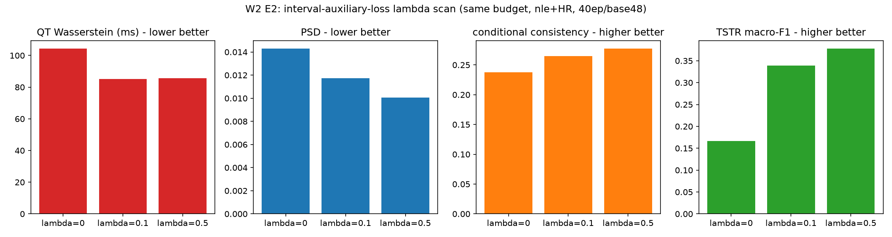
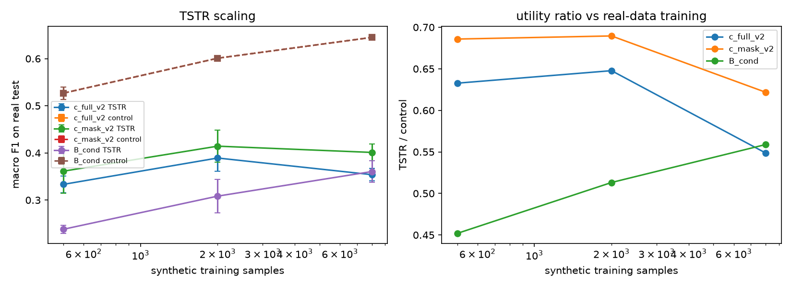
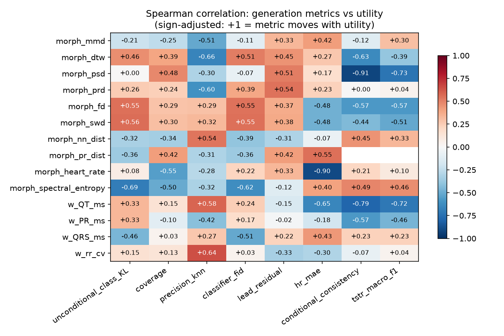
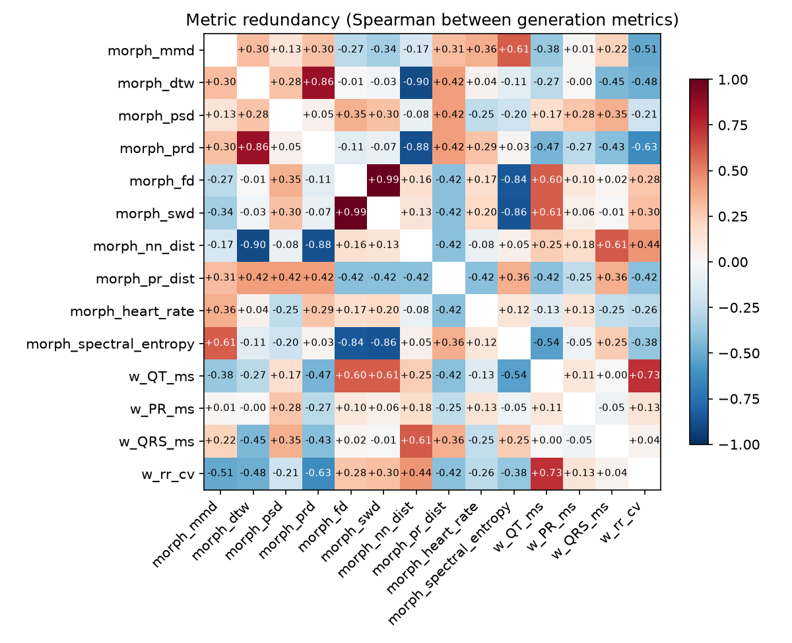

# W2 实验报告：规律注入 λ 扫描 / TSTR 放大 / 指标-效用相关性

> 日期：2026-11-07；数据来源：`results/metrics_*.csv`；可复现命令见文末。
> 背景：v1/v2 基线已完成（`results/summary.md`、`summary_v2.md`）。W2 用三个低成本实验回答作品集最关心的三个问题。

## 摘要（先看这 5 条）

1. **规律注入有效**：同预算下，加间期辅助损失（λ=0.1 或 0.5）使 QT Wasserstein 从 **104.3 ms 降到 ~85.5 ms**，PSD、条件一致率、TSTR 同向改善；
2. **λ 在 0.1–0.5 之间差异不大**：λ=0.1 形态/类别分布更均衡，λ=0.5 的 PSD/RR-CV/PR 误差略好；**建议默认 λ=0.1**；
3. **合成数据存在"数量饱和"**：从 500→2000 条 TSTR 明显提升，但 **2000→8000 基本停滞**（c_full_v2 反而略降），而真实数据同量训练持续上升 → **限制因素不是数量而是质量/多样性**；
4. **mask 标签嵌入版比 nle 版 TSTR 更高**（各样本量下均 ≈+0.03–0.05）→ 再次印证 v2 的"nle 小预算无优势"负结果；
5. **生成指标里 PSD 与 QT Wasserstein 最能反映下游效用**（与 TSTR/条件一致率 |ρ|≈0.72–0.92，p<0.05）；classifier-FID/coverage 与 TSTR 弱相关，形态指标彼此高度冗余 → 报告时选 PSD + QT W 即可。

---

## 1. E2：规律注入的 λ 扫描（同预算对照）

- 问题：间期辅助损失（规律注入）是否有效？λ 取多少？
- 配置：4 个模型**同数据/同 seed/同架构**（nle 标签嵌入 + label+HR 条件，base 48，40 epochs，EMA 0.999），唯一差别是辅助损失权重 λ ∈ {0, 0.1, 0.5}。
- 结果（`results/metrics_w2_lambda_scan.csv`）：

| λ | route | MMD↓ | PSD↓ | QT W↓ | PR W↓ | QRS W↓ | RR-CV W↓ | 条件一致率↑ | 类别 KL↓ | HR MAE↓ | 导联残差↓ | coverage↑ | classifier-FID↓ | TSTR↑ |
|---|---|---|---|---|---|---|---|---|---|---|---|---|---|---|
| 0（无规律注入） | `c_nle_v2` | 0.0007 | 0.0143 | 104.25 | 22.19 | 18.06 | 0.4148 | 0.238 | 2.055 | 21.58 | 0.364 | 0.632 | 78.4 | 0.166 |
| **0.1** | `c_full_v2` | **0.0005** | 0.0117 | **85.15** | 21.16 | **14.69** | 0.4151 | 0.265 | **1.869** | **17.07** | **0.350** | **0.832** | **72.6** | 0.339 |
| 0.5 | `c_aux05_v2` | 0.0008 | **0.0101** | 85.66 | **7.41** | 19.03 | **0.3919** | **0.277** | 2.195 | 18.93 | 0.416 | 0.745 | 73.9 | **0.377** |



**结论**：
- 规律注入有效：QT W 104.3 → 85.2/85.7，PSD 0.0143 → 0.0117/0.0101，条件一致率 0.238 → 0.265/0.277，TSTR 0.166 → 0.339/0.377；
- λ=0.1 与 0.5 各有取舍：λ=0.5 的 PSD/RR-CV/PR 更好，但 MMD/QRS/KL/导联残差略差；**λ=0.1 更均衡**（保留为默认配置）；
- 局限：λ=0.5 仅单 seed；三个点各只有 1 个模型，λ 曲线粗糙。

---

## 2. E6：TSTR 放大（合成数据越多越有用吗？）

- 问题：把合成训练样本从 500 增到 2000/8000，下游效用（TSTR）是否继续提升？
- 方法：为 3 条路线各生成 8000 条条件样本；在 {500, 2000, 8000} 三个规模上从头训练同一个小分类器（base32，30 epochs，3 seeds），在真实 PTB-XL 测试集上评估（TSTR）；control = 同等数量的真实训练样本。
- 结果（`results/metrics_tstr_scaling.csv`，均值±std）：

| route | 合成样本数 | TSTR macro-F1↑ | control（真实数据同量） | TSTR/control |
|---|---|---|---|---|
| `c_full_v2` | 500 | 0.333±0.018 | 0.527±0.013 | 0.633 |
| `c_full_v2` | 2000 | **0.389±0.028** | 0.601±0.003 | **0.648** |
| `c_full_v2` | 8000 | 0.354±0.013 | 0.645±0.003 | 0.549 |
| `c_mask_v2` | 500 | 0.361±0.047 | 0.527±0.013 | 0.686 |
| `c_mask_v2` | 2000 | **0.414±0.034** | 0.601±0.003 | **0.690** |
| `c_mask_v2` | 8000 | 0.401±0.017 | 0.645±0.003 | 0.622 |
| `B_cond`（v1） | 500 | 0.238±0.009 | 0.527±0.013 | 0.452 |
| `B_cond`（v1） | 2000 | 0.308±0.036 | 0.601±0.003 | 0.513 |
| `B_cond`（v1） | 8000 | 0.361±0.013 | 0.645±0.003 | 0.559 |



**结论**：
- **500→2000 有提升（+0.05~0.10），2000→8000 基本停滞甚至略降** → 合成数据存在"数量饱和"；
- 同量真实数据训练（control）随样本量持续上升（0.53→0.60→0.65）→ **限制是合成数据的质量/多样性，而不是样本多少**；
- mask 版（`c_mask_v2`）TSTR 在各规模均高于 nle 版（`c_full_v2`）+0.03~0.05 → 再次印证"nle 在小预算下无优势"；
- 局限：TSTR 用 30 epoch 小分类器、绝对数值低于全量训练；8k 集仅条件样本；3 seeds 方差见上表。

---

## 3. P-B：生成指标与下游效用的相关性（哪个指标可信？）

- 问题：MMD/DTW/PSD/FD 等生成指标，哪些真正与"有用"（TSTR、条件一致率、HR 控制）相关？
- 方法：对 16 条路线（v1/v2/λ=0.5）的 14 个生成指标 × 8 个效用指标做 Spearman 相关（sign-adjusted，正=指标变差时效用也变差/即"指标越好效用越好"）。
- 结果（节选，完整见 `results/metrics_metric_utility.csv`；热图 `fig_metric_utility_heatmap.png`）：

| 生成指标 | 效用指标 | Spearman ρ | p | 路线数 |
|---|---|---|---|---|
| `morph_psd` | 条件一致率 | **−0.915** | 0.0002 | 10 |
| `morph_heart_rate` | HR MAE | −0.900 | 0.0009 | 9 |
| `w_QT_ms` | 条件一致率 | −0.793 | 0.006 | 10 |
| `morph_psd` | TSTR | **−0.729** | 0.017 | 10 |
| `w_QT_ms` | TSTR | **−0.717** | 0.020 | 10 |
| `w_QT_ms` | precision_knn | +0.579 | 0.019 | 16 |
| `morph_swd` / `morph_fd` | 类别 KL / classifier-FID | +0.55 | 0.03 | 16 |




**结论**：
- **PSD 与 QT Wasserstein 是可靠的"效用代理指标"**（与 TSTR/条件一致率 |ρ|≈0.72–0.92，p<0.05）；
- **classifier-FID、coverage 与 TSTR 相关性弱** → 分布距离类指标不能替代下游效用评估；
- **形态指标彼此高度冗余**（MMD/DTW/PRD 强相关，见冗余热图）→ 报告中选 1–2 个代表即可，无需全列；
- 局限：n=9–16 条路线、只有 3 个 seed 的部分指标，Spearman 仅作方向性证据；8k 集未参与相关性分析。

---

## 4. 图表与数据文件

| 文件 | 内容 |
|---|---|
| `results/figures/fig_w2_lambda_scan.png` | λ 扫描 4 面板图 |
| `results/figures/fig_tstr_scaling.png` | TSTR 放大曲线 |
| `results/figures/fig_metric_utility_heatmap.png` | 指标-效用相关性热图 |
| `results/figures/fig_metric_redundancy.png` | 指标冗余热图 |
| `results/metrics_w2_lambda_scan.csv` | λ 扫描明细 |
| `results/metrics_tstr_scaling.csv` | TSTR 放大明细（mean/std/ratio） |
| `results/metrics_metric_utility.csv` | 指标-效用相关明细 |
| `results/metrics_route_feature_table.csv` | 路线 × 指标/效用宽表 |

## 5. 复现命令

```powershell
# λ=0.5 模型（如尚未训练）
powershell -File tools/run.ps1 experiments/train_diffusion.py --name c_aux05_v2 `
    --cond-mode both --cond-style nle --aux-intervals --aux-weight 0.5 `
    --epochs 40 --base 48 --ema-decay 0.999
# 生成 + 全量评估 + 三个 W2 实验（幂等）
powershell -File tools/run_w2.ps1 -SkipTraining
# 单独重跑
powershell -File tools/run.ps1 experiments/eval_tstr_scaling.py
powershell -File tools/run.ps1 experiments/eval_metric_utility.py
powershell -File tools/run.ps1 experiments/make_w2_lambda_figure.py
```

## 6. 对作品集的含义

- **可讲的故事**：规律注入有效（有正结果）、合成数据有数量饱和（负结果）、评估指标选择有依据（方法学结论）——三个都适合写进 README/博客；
- **结论强度**：单卡小预算下的方向性结论，不宣称 SOTA；与文献（SSSD-ECG/nle）的对比只做同口径相对比较；
- **下一步 W3**：把以上结果整理进技术博客 + 3 分钟演示视频 + 一页 PDF（作品集收尾）。
